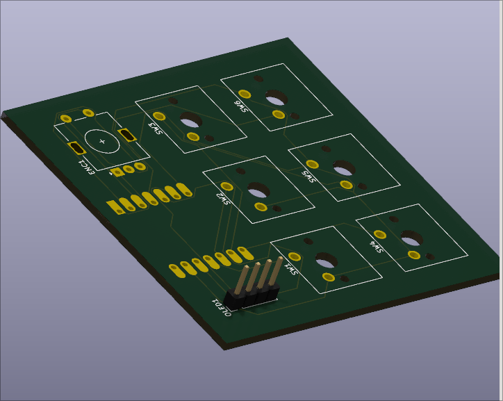
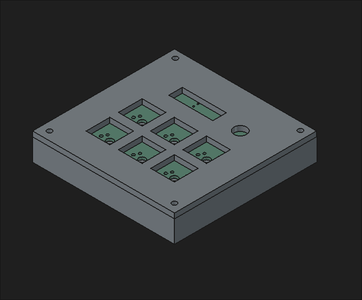

# November 2nd: PCB layout and casing

Well, I um, did maybe some overtime here but uhmm... I managed to get the electronic schematic right, then put an hour or more in wiring everything to then find out you can also run wires on the back, which I then decided to not do. After that I used freecad to design a case. Everything I did was new to me, so I had to spend some time figuring out how freecad and kicad work, cause wthel I've never heard of them before, but now I do get around really well. 

**Total time spent: 5 hours**

# November 3th: Preparing for shipping

So what did I do today, I wrote firmware a readme, al those code editor stuff I can track with hackatime, nothing much really. I'm currently preparing for the ship. Currently the now playing firmware is not on it cause I can edit the firmware later when the soundpad is assembled.

**Total time spent: 1 hours**
