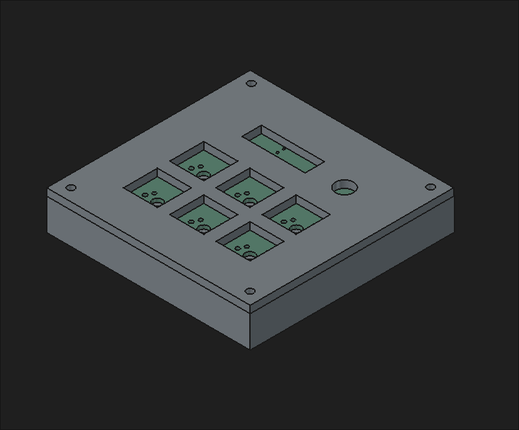
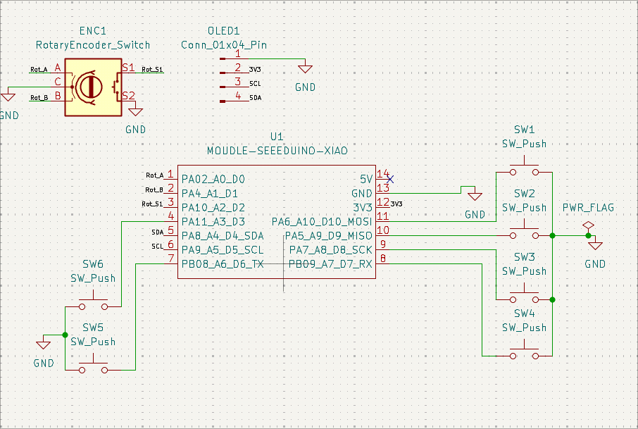
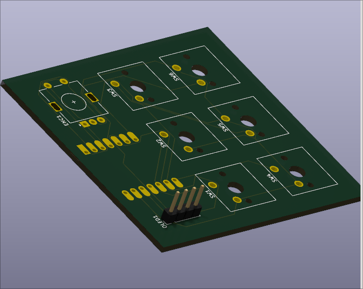
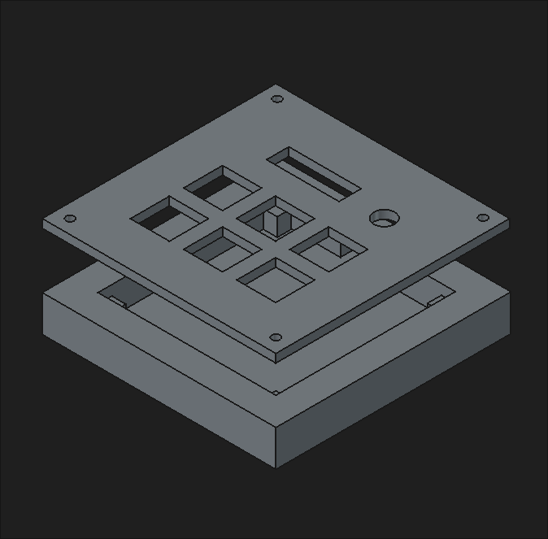

# Macropad

A 6-key media macropad with a rotary encoder and a 0.91" OLED, built around a Seeed XIAO RP2040.

## Features
- 6 MX keys: volume up, mute, volume down, previous, play/pause, next
- Rotary encoder for volume, push to mute
- 128x32 OLED
- KMK firmware

## Schematic

## PCB

## Case
Two printed parts (case and plate), held together by four M3 screws.

## BOM

| Qty | Part | Notes |
| --- | --- | --- |
| 1 | Seeed XIAO RP2040 | Unsoldered, from the kit. Soldered flat to the back of the PCB |
| 6 | MX-style switch | From the kit |
| 6 | White blank DSA keycap | From the kit |
| 1 | EC11E rotary encoder with switch | From the kit, 20 mm D-shaft |
| 1 | Knob cap for the encoder | Not in the kit |
| 1 | 0.91" 128x32 OLED (SSD1306) | From the kit, pin order GND, VCC, SCL, SDA |
| 1 | 1x4 pin header (2.54 mm) | For the OLED |
| 4 | M3x16 mm screw | From the kit |
| 1 | 3D-printed case | Printed |
| 1 | 3D-printed plate | Printed |
| 1 | Custom PCB | Gerbers in `production/gerbers.zip` |

## Firmware
KMK, in `firmware/main.py`.